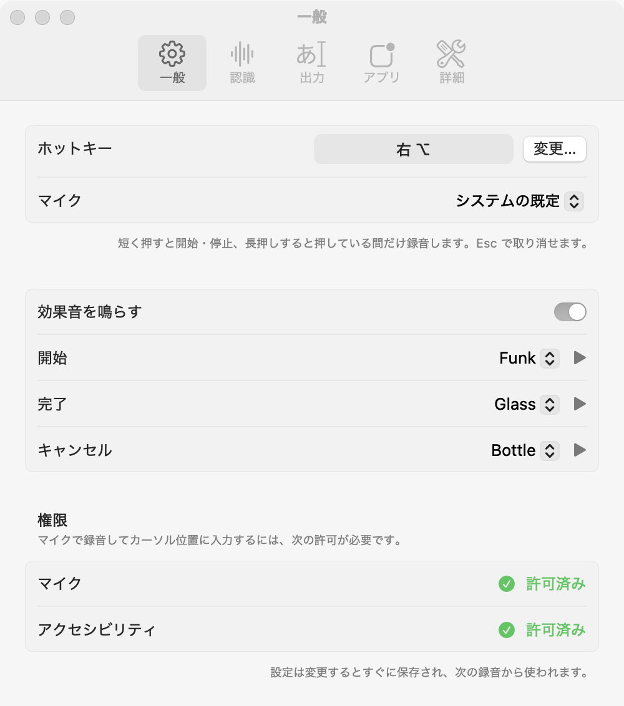

<p align="center"></p>

# iiire

iiire は、話した内容を文字にして、カーソルの位置に入力する macOS のメニューバーアプリです。

書き起こしには [speech.cpp](https://github.com/nyosegawa/speech.cpp) を使用します。音声は Mac 上で処理し、外部には送信しません。


## インストール

macOS 14 以降を搭載した Apple silicon の Mac に対応しています。配布用のアプリはまだないため、ソースからビルドします。ビルドには Command Line Tools と CMake が必要です。Command Line Tools は `xcode-select --install`、CMake は `brew install cmake` でインストールできます。Xcode がインストール済みの場合は、Command Line Tools を別途インストールする必要はありません。

```sh
git clone --recurse-submodules https://github.com/pokutuna/iiire.git
cd iiire
make signing-identity   # 初回のみ
make install
open ~/Applications/iiire.app
```

`make install` はアプリをビルドし、`~/Applications/iiire.app` にインストールします。

初回に実行する `make signing-identity` は、アプリの署名に使う自己署名証明書をログインキーチェーンに作成します。証明書がない場合はアドホック署名が使われ、アプリを再ビルドするたびにアクセシビリティの許可が外れます。

録音にはマイクへのアクセス、テキストの入力にはアクセシビリティの許可が必要です。ペーストに AppleScript を使う設定では、System Events を操作する許可も必要です。

## 使い方

テキストを入力したい場所にカーソルを置き、ホットキーを押して話します。既定のホットキーは右 ⌥ キーです。

| 操作 | 動作 |
|---|---|
| ホットキーを短く押す | 録音を開始する。もう一度押すと録音を終了し、書き起こす |
| ホットキーを長押しする | 押している間だけ録音し、離すと書き起こす |
| Esc を押す | 録音または書き起こしを取り消す |

<p align="center">
  <picture>
    <source media="(prefers-color-scheme: dark)" srcset="docs/hud-recording-dark.png">
    
  </picture>
</p>

ホットキー、マイク、書き起こしに使うモデル、テキストの出力方法は、メニューバーのアイコンから開く設定画面で変更できます。

<p align="center"></p>

モデルは初めて使用するときに Hugging Face からダウンロードされ、`~/Library/Caches/speech.cpp` に保存されます。

## ログ

エラーなどの詳細は `~/Library/Logs/iiire.log` に記録されます。通常のビルドでは、書き起こしたテキストはログに記録されません。開発用のデバッグビルド（`swift build`）では、確認のためにテキストも記録されます。

## 開発

| コマンド | 動作 |
|---|---|
| `make run` | アプリをビルドして起動する |
| `make test` | テストを実行する。XCTest を使うため Xcode が必要 |
| `make clean` | アプリと Swift のビルド結果を削除する |
| `make distclean` | speech.cpp を含むすべてのビルド結果を削除する |

画面の文字列はソースに英語で記述し、日本語訳を `Resources/ja.lproj` に配置しています。アプリのアイコンは、ビルド時に `Resources/AppIcon.svg` から生成します。メニューバーのアイコンは、同じ図形を `Sources/iiire/MenuBarGlyph.swift` で描画しています。

### speech.cpp の更新

speech.cpp は `vendor/speech.cpp` に Git submodule として配置し、バージョンを固定しています。ビルドした `speech` コマンドはアプリに同梱します。バージョンを更新するには、目的のバージョンをチェックアウトし、speech.cpp 自身の submodule も更新してから、その変更を記録します。

```sh
cd vendor/speech.cpp
git checkout <版>
git submodule update --init --recursive
cd ../..
git add vendor/speech.cpp
```

### 動作確認用のコマンド

ビルドしたアプリは、マイクを使わずに音声ファイルを書き起こすことや、録音中などの画面表示を PNG に書き出すこともできます。

```sh
APP=build/iiire.app/Contents/MacOS/iiire
$APP --transcribe /tmp/t.wav [MODEL]
$APP --snapshot-hud /tmp/shots
```
