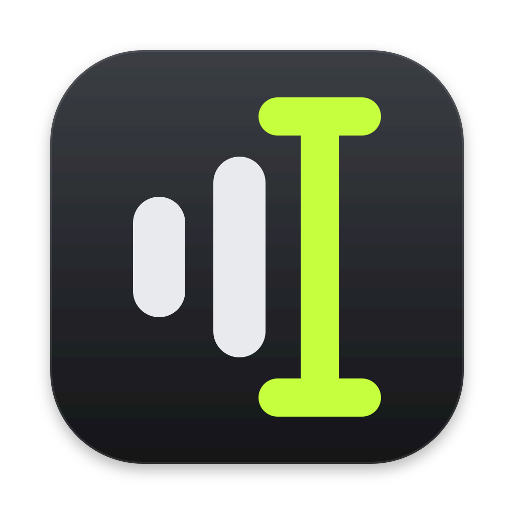
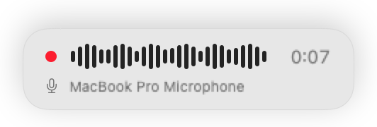
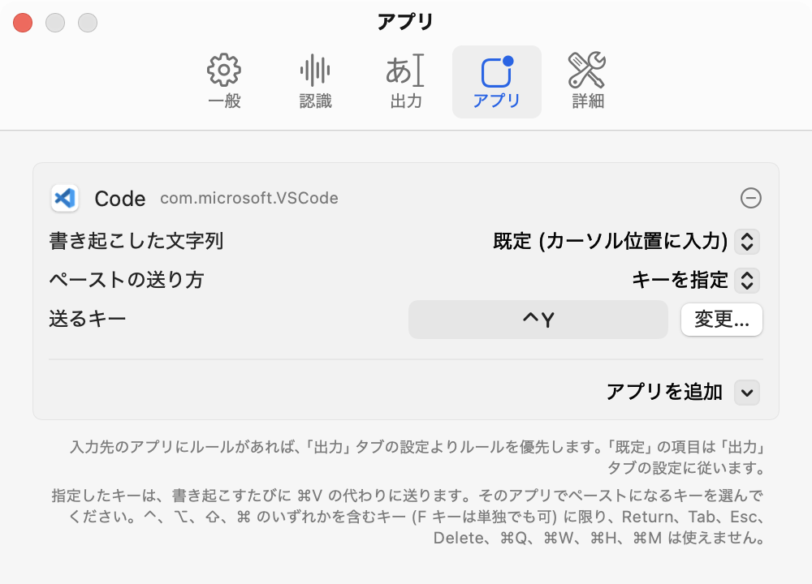

# iiire

/iːiɾe/ - 言い入れ

ホットキーで話した内容を、カーソル位置にテキストとして入力するアプリです。
書き起こしには [speech.cpp](https://github.com/nyosegawa/speech.cpp) を使います。音声は Mac の中だけで処理し、外部には送りません。

## インストール

### 必要な環境

- macOS 14 以降（Apple silicon）
- Command Line Tools（または Xcode）: `xcode-select --install`
- CMake（speech.cpp のビルドに使います）: `brew install cmake`

### 1. ビルドしてインストール

配布バイナリはないため、ソースからビルドして `/Applications/iiire.app` に配置します。
アプリには、`make signing-identity` で各自の Mac に作る自己署名証明書で署名します。

```sh
git clone --recurse-submodules https://github.com/pokutuna/iiire.git
cd iiire
make signing-identity   # 初回のみ: 再ビルド時に権限が外れないよう自己署名証明書を作成
make install            # /Applications にインストールして起動（管理者でなければ INSTALL_DIR=~/Applications を付ける）
```

### 2. マイクとアクセシビリティを許可する（初回のみ）

起動するとメニューバーにアイコンが表示されます。アイコンから「**設定…**」を開き、「一般」タブの下部にある 2 つの権限を許可してください。

- **マイク**: 音声の録音に必要です
- **アクセシビリティ**: カーソル位置へのテキスト入力や、修飾キー単独のホットキー検知に必要です

初回起動時に、音声認識モデル（約 0.66 GB）を Hugging Face からダウンロードします。保存先は speech.cpp のキャッシュディレクトリ `~/Library/Caches/speech.cpp` です。

### 更新するとき

```sh
git pull --recurse-submodules
make install
```

### アンインストール

```sh
rm -rf /Applications/iiire.app
tccutil reset All io.github.pokutuna.iiire   # 権限
defaults delete io.github.pokutuna.iiire     # 設定
```

認識モデルは `~/Library/Caches/speech.cpp`、署名用の証明書はキーチェーンの「iiire Local Signing」に残ります。

## 使い方

テキストを入力したい場所にカーソルを置き、ホットキー（初期設定は **右 ⌥**）を押して話します。

| 操作 | 動作 |
|---|---|
| **ホットキーを短く押す** | 録音を開始。もう一度押すと録音を終了して文字を入力 |
| **ホットキーを長押しする** | 押している間だけ録音し、離すと文字を入力 |
| **Esc を押す** | 録音または書き起こしをキャンセル |

録音中は画面下部にオーバーレイが表示され、波形、経過時間、使用中のマイクを確認できます。書き起こし中や入力の結果、エラーもここに表示されます。

<picture>
  <source media="(prefers-color-scheme: dark)" srcset="docs/images/hud-recording-dark.png">
  
</picture>

## 設定

メニューバーアイコンの「**設定…**」（`⌘,`）から変更できます。


- **ホットキー・マイク（一般）**
  - 右 ⌥・右 ⌘・Fn などの修飾キー単独、または `⌥Space` などのキーの組み合わせをホットキーに登録できます。
- **認識モデル・語彙登録（認識）**
  - 日本語の入力には、高速で語彙登録にも対応している **Haas ja v1.0**（既定）がおすすめです。他のモデルも選択時に自動でダウンロードされます。
    - [Haas ja v1.0](https://huggingface.co/sakasegawa/Haas-ja-v1.0-GGUF)（**おすすめ・既定** / 日本語・高速 / 固有名詞の「表記=読み」登録に対応）
    - [ReazonSpeech v2](https://huggingface.co/sakasegawa/reazonspeech-nemo-v2-GGUF)（日本語）
    - [Parakeet TDT-CTC ja](https://huggingface.co/sakasegawa/parakeet-tdt_ctc-0.6b-ja-GGUF)（日本語・短い発話向け）
    - [Qwen3-ASR 0.6B](https://huggingface.co/sakasegawa/Qwen3-ASR-0.6B-GGUF) / [1.7B](https://huggingface.co/sakasegawa/Qwen3-ASR-1.7B-GGUF)（多言語 / ヒント・プロンプト指定に対応）
- **出力方法・アプリ別ルール（出力・アプリ）**
  - 「カーソル位置に入力（元のクリップボードを復元）」「入力してクリップボードにも残す」「クリップボードにコピーのみ」から選択できます。
  - ペースト時のキー送信方法を変更できるほか、独自のキーバインドを設定したエディタなど、`⌘V` 以外でペーストするアプリごとに個別のルール（`⌃Y` を送るなど）を設定できます。

    

## トラブルシューティング

- **文字が入力されない**: 「設定…」>「一般」でアクセシビリティが「許可済み」になっているか確認してください。
- **Dvorak 等のカスタム配列で `⌘V` が効かない**: 「設定…」>「出力」の「ペーストの送り方」を「AppleScript (System Events) で ⌘V」または「キーを指定」に変更してください。
- **前のクリップボードの内容が貼られてしまう**: 「設定…」>「出力」の「ペーストのタイミング」で「クリップボードを戻すまで」の時間を少し長くしてください。
- **ログの確認**: エラーの詳細は `~/Library/Logs/iiire.log` に記録されます（通常のリリースビルドでは書き起こしたテキスト自体は記録されません）。

## 開発

| コマンド | 動作 |
|---|---|
| `make app` | `build/iiire.app` をビルドする |
| `make run` | アプリをビルドして起動する |
| `make test` | テストを実行する（XCTest を使うため Xcode が必要） |
| `make update-speech` | `speech.cpp` を新しいバージョンに更新する |
| `make clean` | アプリと Swift のビルド結果を削除する |
| `make distclean` | `speech.cpp` を含むすべてのビルド結果を削除する |

- UI の文字列はソースコードに英語で記述し、日本語訳を `Resources/ja.lproj/Localizable.strings` に配置しています。
- アプリアイコンはビルド時に `Resources/AppIcon.svg` から生成し、メニューバーアイコンは同じ図形を `Sources/iiire/MenuBarGlyph.swift` で描画しています。
- デバッグビルド（`swift build`）では、動作確認のため書き起こしたテキストもログに記録されます。

### 動作確認用の CLI オプション

```sh
APP=build/iiire.app/Contents/MacOS/iiire
$APP --transcribe /tmp/sample.wav [MODEL]   # 音声ファイルを書き起こす
$APP --snapshot-settings /tmp/shots         # 設定画面の各タブを PNG に書き出す
$APP --snapshot-hud /tmp/shots              # オーバーレイの各状態を PNG に書き出す
```

### speech.cpp の更新

`speech.cpp` は `vendor/speech.cpp` に Git submodule として配置し、ビルドした `speech` バイナリをアプリに同梱しています。
次のコマンドで submodule を最新のタグ（`REF` を指定するとそのタグやコミット）に更新してステージします。続けてコミットしてください。

```sh
make update-speech              # 最新のタグに更新する
make update-speech REF=v0.10.1  # 指定したバージョンに更新する
```
